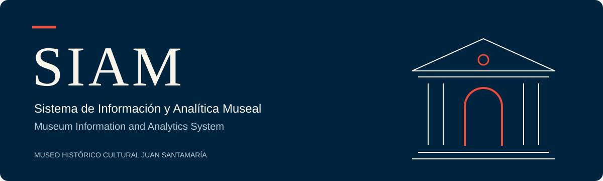

<div align="center">



**Museo Histórico Cultural Juan Santamaría · Alajuela, Costa Rica**

[Español](README.md) · [English](README.en.md) · [Frontend](frontend/README.md) · [Backend](backend/README.md)

**Vue 3** &nbsp; / &nbsp; **Vite** &nbsp; / &nbsp; **Django REST Framework** &nbsp; / &nbsp; **SQLite**

Academic project in development<br>
Software Requirements · Tecnológico de Costa Rica

</div>

---

**SIAM** manages visitors, events, and collections for the Museo Histórico Cultural Juan Santamaría, with public information and role-based administrative access.

| Module | Functionality |
| :--- | :--- |
| **Public information** | Find museum information, opening hours, events, and the privacy policy. |
| **Visitors** | Record entries by age group, nationality category, and sex, without requesting visitors' names or identity numbers. |
| **Events** | Browse the calendar, manage activities, and record actual attendance. |
| **Collections** | Manage pieces, photos, locations, loans, decommissions, and theft or loss records. |
| **Reports** | View attendance and consolidated reports; export PDF and Excel files according to permissions. |
| **Administration** | Manage accounts, roles, museum configuration, and the activity audit log. |

The interface supports **Spanish and English**, **light and dark themes**, and layouts that adapt to mobile devices. Internal access uses sessions and role permissions: guard, coordinator, museologist, general administrator, and system administrator.

## Local installation

Requirements: **Python 3.10 or later**, **Node.js 22.18 or later**, and **npm**. Run the commands in Bash from the repository root, in two separate terminals.

**Backend**

```bash
cd backend
python3 -m venv .venv
source .venv/bin/activate
python -m pip install -r requirements.txt
export DJANGO_SECRET_KEY="$(python -c 'import secrets; print(secrets.token_hex())')"
python manage.py migrate
python crear_usuarios_demo.py
python manage.py runserver 127.0.0.1:8000
```

Reuse `DJANGO_SECRET_KEY` to preserve sessions across restarts. Keep the key out of the repository.

The migration history has been reset. Databases from earlier versions must be recreated; see the [reset procedure (Spanish)](backend/README.md#reinicio-del-historial-de-migraciones). This deletes local data.

**Frontend**

```bash
cd frontend
npm ci
cp .env.example .env
npm run dev
```

Open **[127.0.0.1:5173](http://127.0.0.1:5173/)**. Staff sign in at **[/login](http://127.0.0.1:5173/login)** and go directly to the event calendar.

Use `127.0.0.1` for both servers. Set `VITE_API_BASE_URL` to `http://127.0.0.1:8000/api/`, including the trailing slash. Restart Vite after changing it.

## Test accounts

The development script creates one account per role and preserves existing accounts. All use the password **`Demo12345`** and are **for local development only**.

| Role | Email |
| :--- | :--- |
| Guard | `guarda@demo.siam.test` |
| Coordinator | `coordinador@demo.siam.test` |
| Museologist | `museologo@demo.siam.test` |
| General administrator | `administrador_general@demo.siam.test` |
| System administrator | `administrador_sistema@demo.siam.test` |

## Repository structure

```text
siam/
├── frontend/                  Vue interface
│   └── src/
│       ├── components/        Screens and forms
│       ├── i18n/              Spanish and English
│       └── theme/             Light and dark themes
├── backend/                   Django REST API
│   ├── api/                   Authentication, events, reports
│   ├── visitors/              Visitor records
│   ├── incidents/             Incident records
│   ├── collection_integrity/  Museum collection
│   ├── audit/                 Activity log
│   └── system_configuration/  Museum settings
└── docs/assets/               README artwork
```
