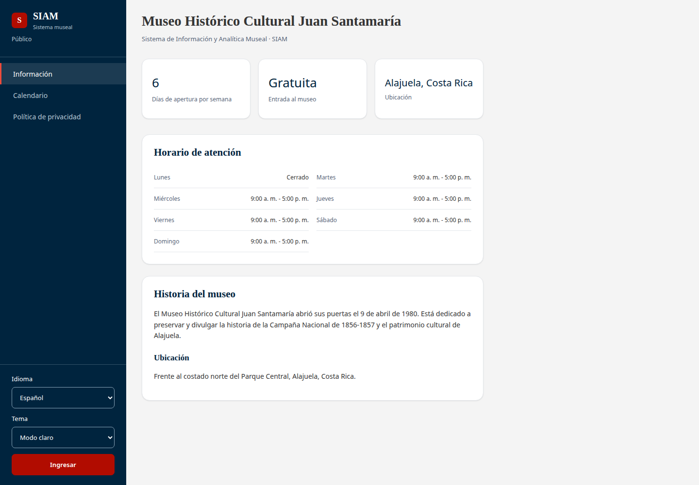
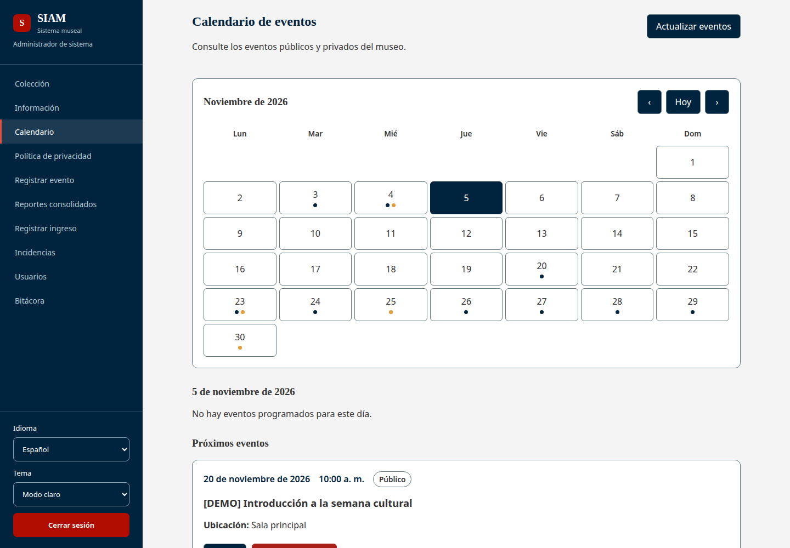
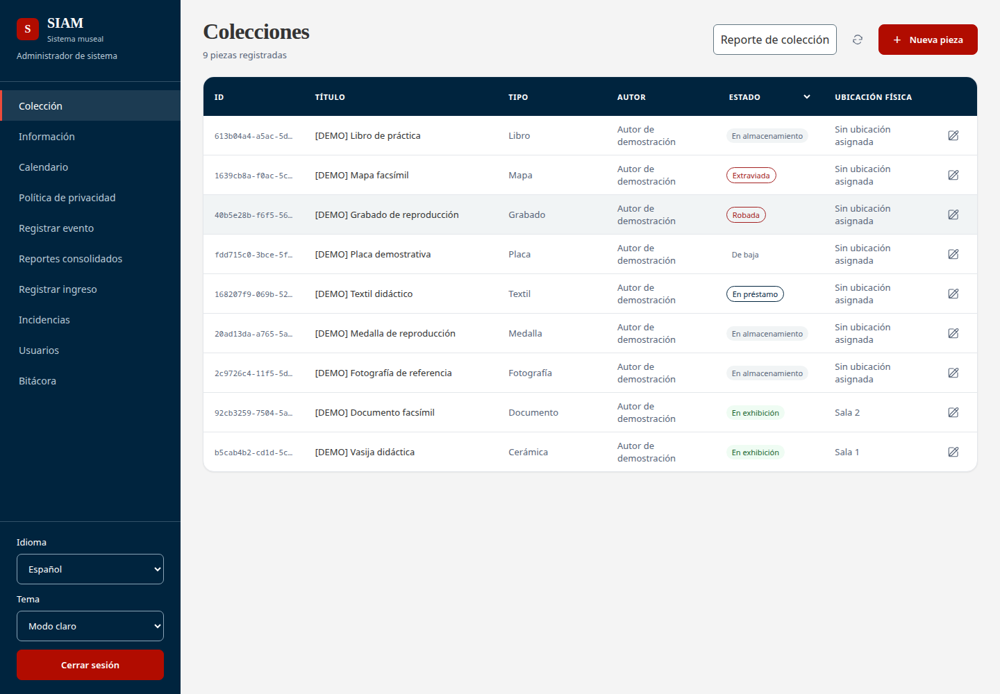
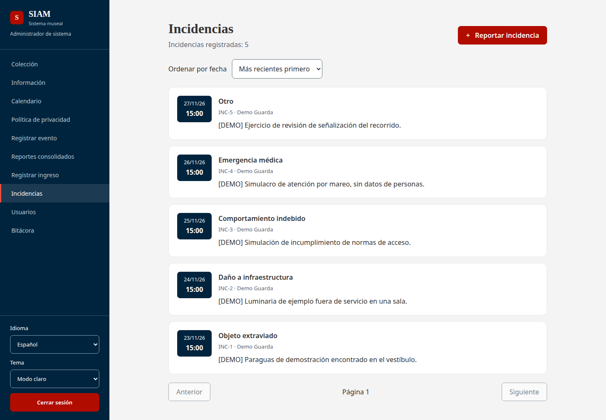
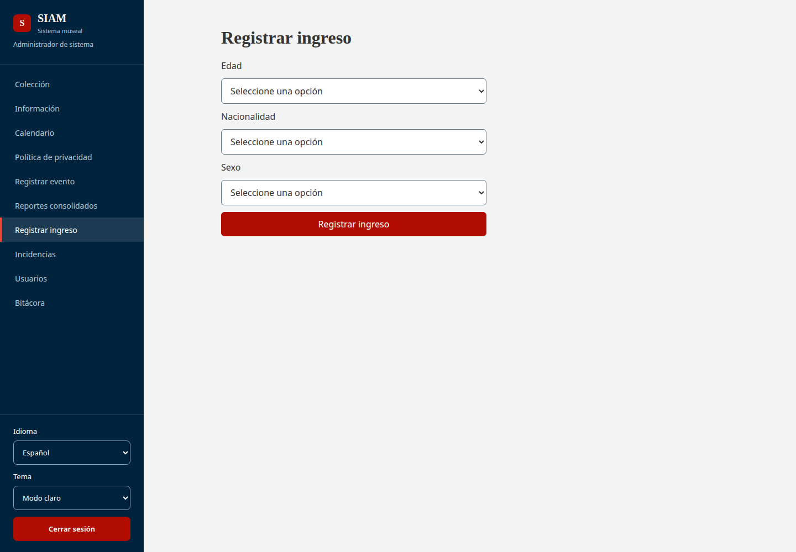
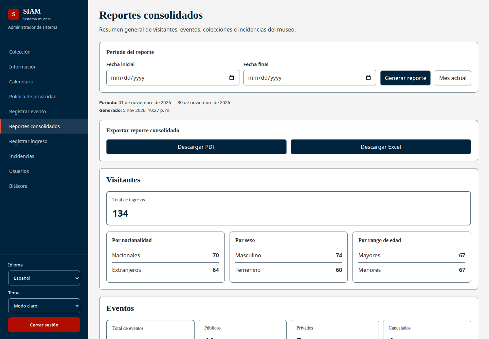

<div align="center">


**Caso de estudio: Museo Histórico Cultural Juan Santamaría · Alajuela, Costa Rica**

[Español](README.md) · [English](README.en.md) · [Frontend](frontend/README.md) · [Backend](backend/README.md) · [API](docs/api.es.md)

**Vue 3** &nbsp; / &nbsp; **Vite** &nbsp; / &nbsp; **Django REST Framework** &nbsp; / &nbsp; **SQLite**

Sistema hipotético · Proyecto académico en desarrollo<br>
Requerimientos del Software · Tecnológico de Costa Rica

</div>

---

**SIAM** es un sistema hipotético de gestión de visitantes, eventos y colecciones, desarrollado como proyecto académico tomando al Museo Histórico Cultural Juan Santamaría como caso de estudio. No es un sistema oficial del museo ni representa una iniciativa institucional. Incluye información pública y acceso administrativo por roles.

| Módulo | Funcionalidad |
| :--- | :--- |
| **Información pública** | Consultar la información del museo, horarios, eventos y política de privacidad. |
| **Visitantes** | Registrar ingresos por grupo de edad, nacionalidad y sexo, sin solicitar nombres ni cédulas de visitantes. |
| **Eventos** | Consultar el calendario, gestionar actividades y registrar la asistencia real. |
| **Incidencias** | Consultar el historial paginado, ordenar por fecha y registrar nuevas incidencias. |
| **Colecciones** | Gestionar piezas, fotografías, ubicaciones, préstamos, bajas y registros de robo o extravío. |
| **Reportes** | Consultar asistencia y reportes consolidados con incidencias por categoría; exportar en PDF y Excel según los permisos. |
| **Administración** | Gestionar cuentas, roles, configuración del museo y bitácora de actividad. |

La interfaz incluye **español e inglés**, **tema claro y oscuro** y navegación adaptable a dispositivos móviles. El acceso interno se controla mediante sesiones y permisos por rol: guarda, coordinador, museólogo, administrador general y administrador de sistema.

## Galería

Capturas con datos de demostración. Seleccione una imagen para verla en tamaño completo.

| Información del museo | Calendario de eventos |
| :---: | :---: |
| [](docs/assets/screenshots/museum.png) | [](docs/assets/screenshots/calendar.png) |
| **Colección** | **Incidencias** |
| [](docs/assets/screenshots/collection.png) | [](docs/assets/screenshots/incidents.png) |
| **Registro de visitantes** | **Reportes consolidados** |
| [](docs/assets/screenshots/visitors.png) | [](docs/assets/screenshots/reports.png) |

## Docker

Requiere Docker con Compose. No necesita instalar Python ni Node.js en el equipo.

**Primera vez:** copie `.env.example` como `.env` y defina `DJANGO_SECRET_KEY` con una clave aleatoria de al menos 32 caracteres. Puede generarla con `openssl rand -hex 32`. Este archivo es independiente de `frontend/.env` y no se sube al repositorio.

Desde la raíz del repositorio:

```bash
docker compose up --build -d
docker compose exec backend python cargar_datos_demo.py
```

Abra **http://127.0.0.1:5173/**. Las migraciones se aplican al iniciar el backend; los datos de demostración se cargan con el segundo comando.

| Acción | Comando |
| :--- | :--- |
| Ver registros | `docker compose logs -f` |
| Detener | `docker compose down` |
| Volver a iniciar | `docker compose up -d` |
| Aplicar cambios de código o dependencias | `docker compose up --build -d` |

SQLite se guarda en un volumen propio, separado de `backend/db.sqlite3`. Detener o recrear los contenedores conserva los datos. `docker compose down -v` elimina el volumen y sus datos.

Esta configuración es para desarrollo y demostraciones locales; usa los servidores de desarrollo de Django y Vite.

Para desarrollar sin contenedores, consulte la [guía de desarrollo local](docs/development.md).

## Documentación de la API

Consulte la [referencia de la API](https://rgdan.github.io/siam/) para conocer los endpoints, campos y respuestas. La [guía de la API](docs/api.es.md) explica la autenticación por sesión y los permisos para consumirla desde cualquier cliente HTTP.

## Cuentas de prueba

El script carga cuentas por rol, piezas con imágenes de muestra, eventos, ingresos, incidencias y configuración para la semana del **23–29 de noviembre de 2026**. Incluye eventos anteriores para demostrar reportes de asistencia. Puede repetirse sin duplicar ni sobrescribir los registros existentes; consulte los [detalles del escenario](backend/README.md#datos-de-demostración).

Todas las cuentas usan la contraseña **`Demo12345`** y son **solo para desarrollo local**.

| Rol | Correo |
| :--- | :--- |
| Guarda | `guarda@demo.siam.test` |
| Coordinador | `coordinador@demo.siam.test` |
| Museólogo | `museologo@demo.siam.test` |
| Administrador general | `administrador_general@demo.siam.test` |
| Administrador de sistema | `administrador_sistema@demo.siam.test` |

## Estructura del repositorio

```text
siam/
├── frontend/                  Interfaz Vue
│   └── src/
│       Pantallas y formularios
│       Español e inglés
│       Temas claro y oscuro
├── backend/                   Django REST API
│   Acceso, eventos, reportes
│   Registro de visitantes
│   Registro de incidencias
│   Colección del museo
│   Bitácora
│   Configuración del museo
└── docs/assets/               Recursos del README
```
